# ROS 2 User Manual

> **📺 Before you begin, please watch these videos:**
> - **Docker Tutorial**: https://www.youtube.com/watch?v=DQdB7wFEygo
> - **ROS 2 Tutorial Playlist**: https://www.youtube.com/watch?v=0aPbWsyENA8&list=PLLSegLrePWgJudpPUof4-nVFHGkB62Izy

Welcome to the exciting world of robotics development! This manual is designed specifically for junior college students starting their journey with the **Robot Operating System 2 (ROS 2)**. 

## Using Docker to Run ROS 2

Docker is a fantastic tool that lets us run ROS 2 in an isolated environment called a "container". This means you don't have to worry about complicated installations or messing up your computer's setup!

### Prerequisites
* Install [Docker Desktop](https://www.docker.com/products/docker-desktop/) on your computer.
* Ensure Docker is running.

---

## Section 1: Running ROS 2 in a Docker Container
### Step 1: Start a ROS 2 Desktop Container

We'll use the **desktop** image which includes GUI tools like **turtlesim** and **RViz**.

#### macOS — Install XQuartz (for GUI forwarding)

GUI apps inside Docker need an X server on your Mac. Install [XQuartz](https://www.xquartz.org/), then:

1. Open **XQuartz** (it will appear in your menu bar).
2. Go to **XQuartz → Settings → Security** and check **"Allow connections from network clients"**.
3. **Quit and re-open XQuartz** (important!).
4. if still cannot connect to GUI, run `xhost +localhost` before starting the container.

#### Windows — Install VcXsrv

1. Download and install [VcXsrv](https://sourceforge.net/projects/vcxsrv/).
2. Launch **XLaunch** from the Start menu.
3. In the wizard:
   - **Display settings**: Keep **Multiple windows** selected, Display number = `0`. Click **Next**.
   - **How to start clients**: Select **Start no client**. Click **Next**.
   - **Extra settings**: Check **Disable access control** (very important!). Click **Next**.
   - Click **Finish**.
4. VcXsrv will appear in your system tray. If your firewall asks, allow it on **private networks**.

#### Linux — Install an X server

Your Linux system likely already has one. If not, install `xauth`:
```bash
sudo apt install xauth
```

#### Launch the container

Run this command to download and start a ROS 2 "Jazzy" desktop container with GUI support:

**macOS:**
```bash
docker run -it --name ros2_container \
  -e DISPLAY=host.docker.internal:0 \
  -v /tmp/.X11-unix:/tmp/.X11-unix \
  osrf/ros:jazzy-desktop
```

**Windows (PowerShell) — find your host IP first:**
```powershell
ipconfig
```
Look for the **IPv4 Address** under the active network adapter (e.g. `192.168.x.x`). Then use that IP:
```powershell
docker run -it --name ros2_container `
  -e DISPLAY=YOUR_IP_ADDRESS:0 `
  osrf/ros:jazzy-desktop
```

**Linux:**
```bash
docker run -it --name ros2_container \
  -e DISPLAY=$DISPLAY \
  -v /tmp/.X11-unix:/tmp/.X11-unix \
  osrf/ros:jazzy-desktop
```

* `run -it`: Runs the container interactively so you can type commands.
* `--name ros2_container`: Gives our container a friendly name.
* `-e DISPLAY=...`: Forwards your display so GUI windows appear on your screen.
* `-v /tmp/.X11-unix:...`: Shares the X11 socket with the container.
* `osrf/ros:jazzy-desktop`: The ROS 2 Jazzy desktop image from OSRF (includes turtlesim, RViz, Gazebo, etc.).

Type `exit` and press Enter once to return to your host terminal.

---

## Section 2: Running ROS 2 Examples

### Step 1: Run the Talker & Listener Example

Open two terminal windows on your host machine.

**Terminal 1 — Enter the container (if not already in it):**
```bash
docker exec -it ros2_container bash
```

Then source ROS 2 and run the talker:
```bash
source /opt/ros/jazzy/setup.bash
ros2 run demo_nodes_cpp talker
```

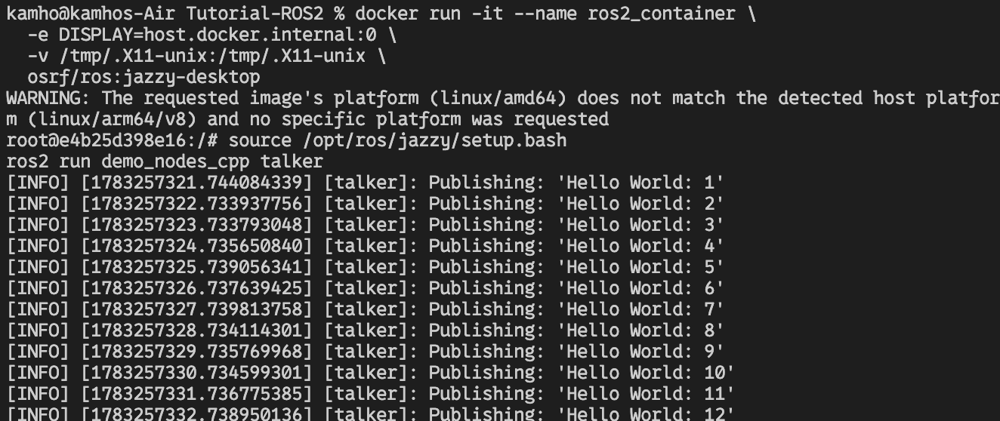

**Terminal 2 — Enter the same container:**
```bash
docker exec -it ros2_container bash
```

Source ROS 2 and run the listener:
```bash
source /opt/ros/jazzy/setup.bash
ros2 run demo_nodes_py listener
```

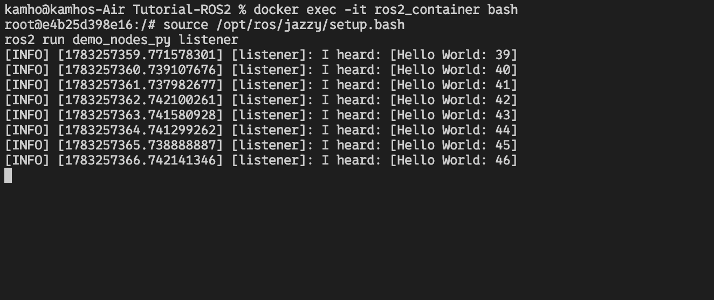

You should see the listener receiving messages like `I heard: 'Hello World: 1'`.

**Visualize with rqt_graph** — Open a **third terminal** and enter the container:
```bash
docker exec -it ros2_container bash
```

```bash
source /opt/ros/jazzy/setup.bash
rqt_graph
```

A window will appear showing a block diagram of your ROS 2 system — the `/talker` node publishing to the `/chatter` topic and the `/listener` node subscribing to it.

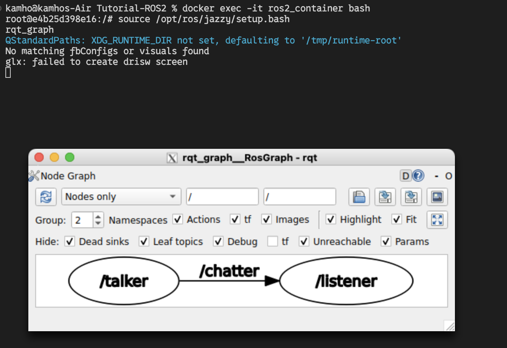

### Step 2: Run turtlesim

First, make sure XQuartz (on macOS) or your X server (on Linux) is running.

**Terminal 1 — Enter the container and start turtlesim:**
```bash
docker exec -it ros2_container bash
```

```bash
source /opt/ros/jazzy/setup.bash
ros2 run turtlesim turtlesim_node
```

A blue window with a turtle should appear! This is your turtlesim simulator.

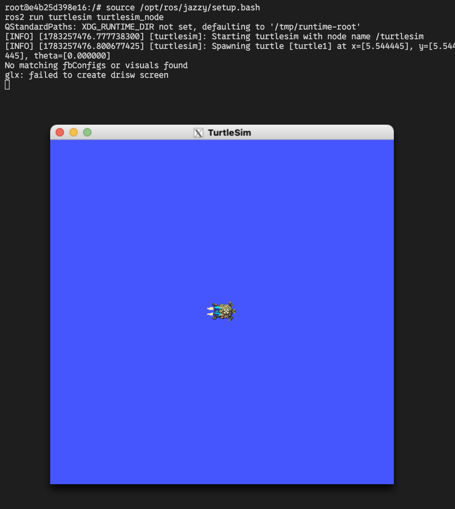

**Terminal 2 — Enter the container and control the turtle:**
```bash
docker exec -it ros2_container bash
```

```bash
source /opt/ros/jazzy/setup.bash
ros2 run turtlesim turtle_teleop_key
```

Click on the **Terminal 2** window (so your keyboard inputs go there) and use the arrow keys to move the turtle around!

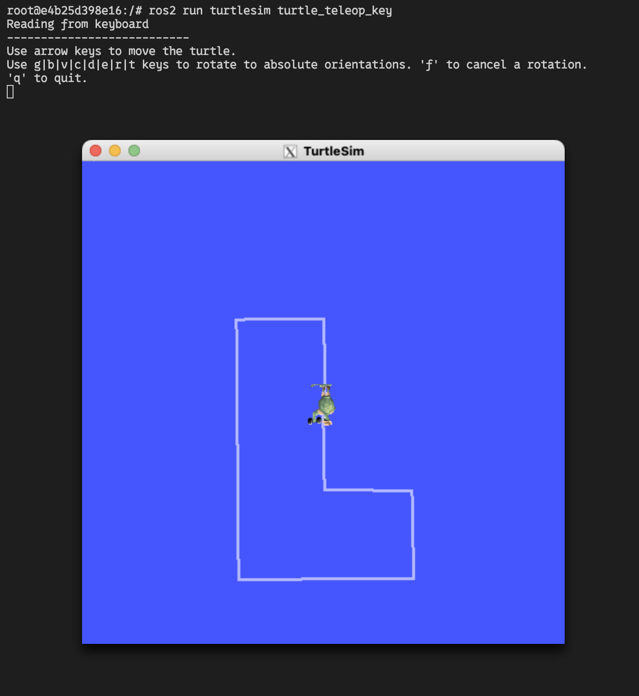

**Draw the first letter of your last name!**
Using the arrow keys, try to trace the first letter of your surname. For example, if your name is **Leung**, draw an **"L"** — move down, then right. If your name is **Chan**, draw a **"C"** with a curved motion. Take a screenshot and share it!


### Step 3: Cleaning Up

When you are done experimenting, you can stop the nodes by pressing `Ctrl + C` in both terminals. To exit the container, simply type:

```bash
exit
```

To clean up and remove the container completely, run this in your normal terminal:

```bash
docker rm -f ros2_container
```

---

## Section 3: Git Branching and Version Control

Git is a version control system that tracks changes to your code. Branching lets you work on your own copy of the code without affecting others. You'll create a branch named after yourself and set up a `.gitignore` file to keep unwanted files out of the repository.

### Step 1: Check Your Git Status

First, make sure you are on the `main` branch and your working tree is clean:

```bash
git status
```

### Step 2: Create a Branch with Your Name

Create and switch to a new branch named after your **full name** (use lowercase, replace spaces with hyphens):

```bash
git checkout -b {your_name}
```

For example, if your name is **Chan Tai Man**, run:

```bash
git checkout -b chan-tai-man
```

* `checkout -b`: Creates a new branch **and** switches to it in one command.
* Verify your new branch with `git branch` — the asterisk `*` marks your active branch.

### Step 3: Create a `.gitignore` File

A `.gitignore` file tells Git which files and folders to **ignore** (not track). This keeps your repository clean of temporary files, Docker artifacts, Python cache files, and editor junk.

Create a file named `.gitignore` in the root of your repository:

```gitignore
# Python
__pycache__/
*.pyc
*.pyo
*.egg-info/

# ROS 2 build artifacts
build/
log/
install/

# Docker
.docker/

# macOS
.DS_Store

# IDE / Editor
.vscode/
.idea/
*.swp
*.swo
*~
```

* `__pycache__/`: Python bytecode cache (auto-generated when you run Python code).
* `build/`, `log/`, `install/`: ROS 2 `colcon build` output directories.
* `.DS_Store`: macOS folder metadata files.
* `.vscode/`, `.idea/`: Editor/IDE settings (each person's setup is different).

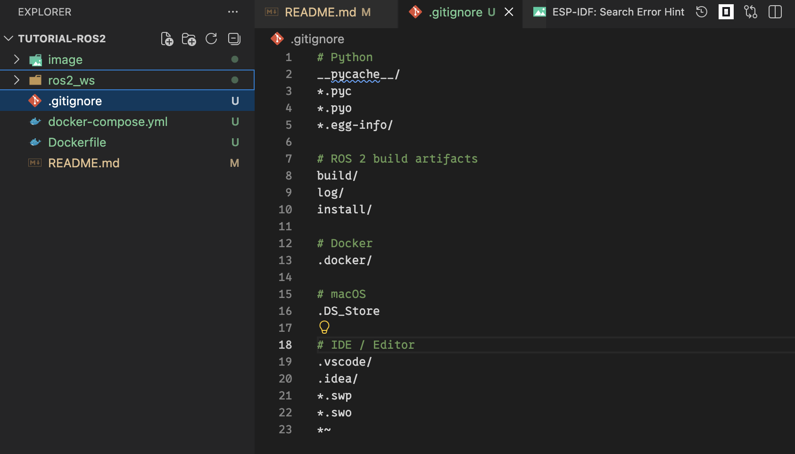

### Step 4: Stage, Commit, and Push

Add the `.gitignore` to the staging area, commit it, and push your branch to the remote:

```bash
git add .gitignore
git commit -m "Add .gitignore and create {your_name} branch"
git push -u origin {your_name}
```

* `git add`: Stages the file for commit.
* `git commit`: Records the changes with a descriptive message.
* `git push -u origin {your_name}`: Uploads your branch to GitHub and sets it to track the remote branch.

**or use vscode git GUI to stage, commit, and push.**

**or use the GitHub Desktop app to stage, commit, and push.**

### Step 5: Verify on GitHub

Go to your repository on GitHub. You should see your new branch listed in the branch dropdown menu, and the `.gitignore` file should appear in the file list.

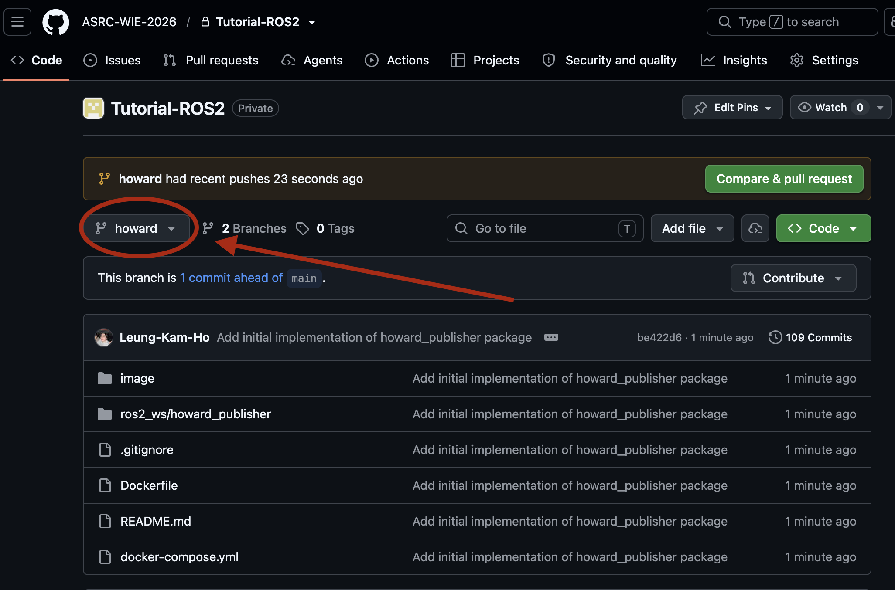

> **Tip:** Whenever you re-enter the container or pull new changes, run `git status` first to see which branch you're on and whether you have any uncommitted work.

---

## Section 4: Dockerfiles and Custom ROS 2 Images

A **Dockerfile** is a recipe that tells Docker how to build a custom image. Instead of using the generic `osrf/ros:jazzy-desktop` image, you can create your own image with your ROS 2 packages pre-installed.

> **⚠️ Important:** Everywhere you see `{your_name}`, replace it with **your actual name** (e.g., `chan_ros2_image`, `howard_publisher`). Use lowercase and underscores — no spaces!

### 4.1 Create a Dockerfile

Create a file named `Dockerfile`:

```dockerfile
# Start from the official ROS 2 Jazzy desktop image
FROM osrf/ros:jazzy-desktop

# Use bash for RUN commands (setup.bash requires bash)
SHELL ["/bin/bash", "-c"]

# Install additional tools (optional)
RUN apt-get update && apt-get install -y \
    nano \
    ros-jazzy-turtlesim \
    && rm -rf /var/lib/apt/lists/*

# Create a workspace
RUN mkdir -p /ros2_ws/src

# Source ROS 2 automatically when you enter the container
RUN echo "source /opt/ros/jazzy/setup.bash" >> ~/.bashrc

# Set the working directory
WORKDIR /ros2_ws

# Default command
CMD ["bash"]
```

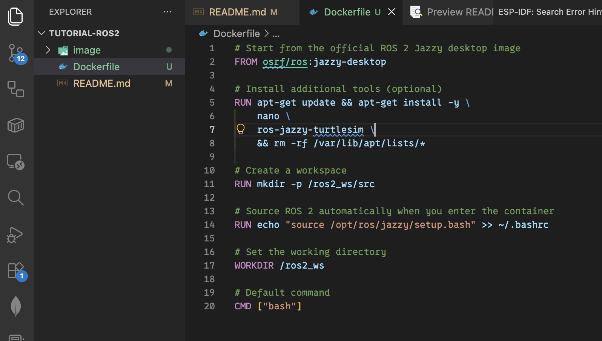

### 4.2 Build the Custom Image

Open a terminal in the folder containing your `Dockerfile` and run:

```bash
docker build -t {your_name}_ros2_image .
```

* `-t {your_name}_ros2_image`: Tags your image with a name of your choice.
* `.`: Tells Docker to look for the `Dockerfile` in the current directory.

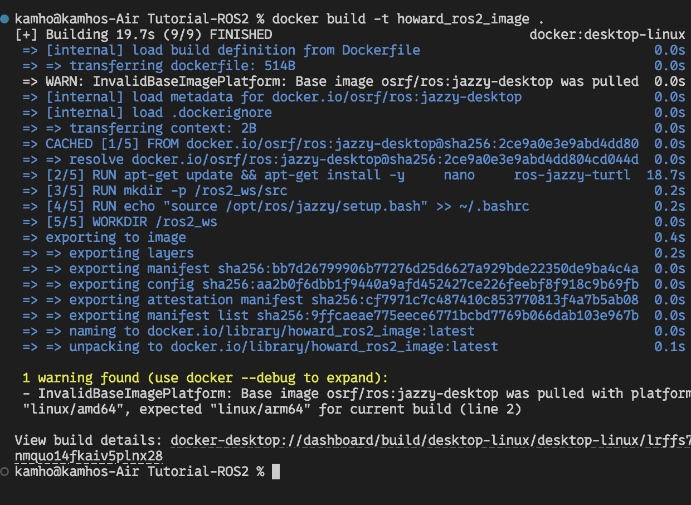

### 4.3 Run Your Custom Image

```bash
docker run -it --name {your_name}_ros2_container \
  -e DISPLAY=host.docker.internal:0 \
  -v /tmp/.X11-unix:/tmp/.X11-unix \
  {your_name}_ros2_image
```

ROS 2 will already be sourced (thanks to `.bashrc`), and you can immediately run ROS 2 commands and turtlesim.

### 4.4 Docker Compose & Volume Mounting

Instead of baking code into the image with `COPY`, it's better to **mount a volume** — this lets you edit code on your host machine while running it inside the container. Changes are instant, no rebuild needed.

#### 4.4.1 Create a `docker-compose.yml`

Create a file named `docker-compose.yml` alongside your `Dockerfile`:

```yaml
services:
  ros2:
    build: .
    image: {your_name}_ros2_image
    container_name: {your_name}_ros2_container
    stdin_open: true
    tty: true
    environment:
      - DISPLAY=host.docker.internal:0
    volumes:
      - ./ros2_ws:/ros2_ws
    working_dir: /ros2_ws
```

* `volumes`: Maps your host `./ros2_ws` folder into the container at `/ros2_ws` — files persist on your computer.
* `working_dir`: Starts you inside `/ros2_ws` automatically.

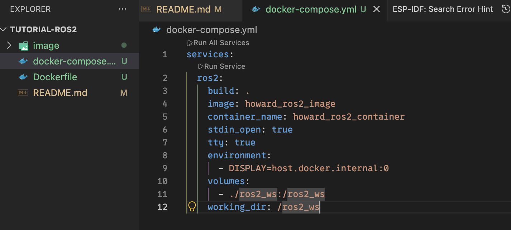

#### 4.4.2 Start the Container with Docker Compose

```bash
docker compose up -d
```

`-d` runs it in the background. Enter the container with:

```bash
docker compose exec ros2 bash
```

*or* use docker desktop to open a terminal in the container.

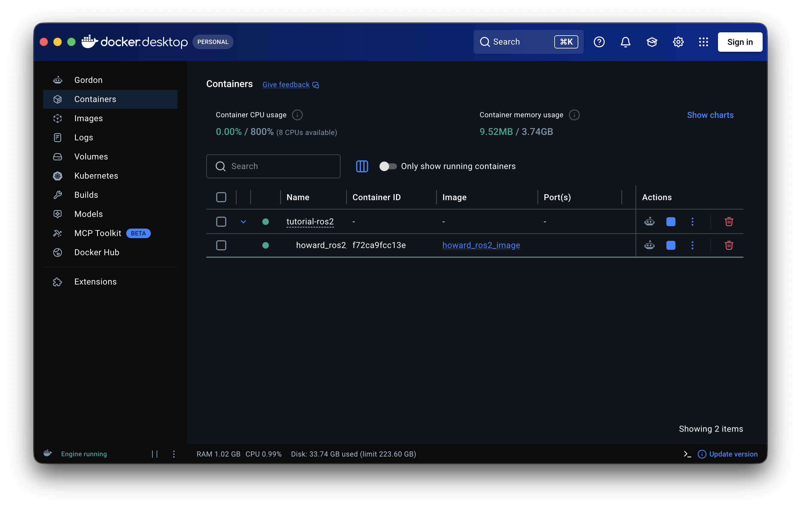
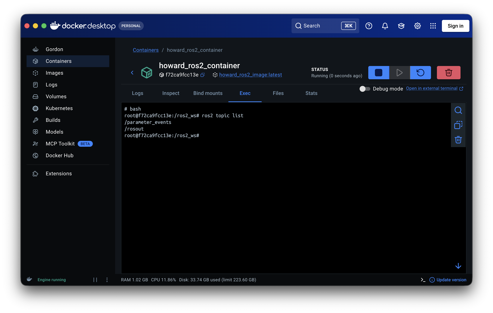

#### 4.4.3 Create a Package Using Official ROS 2 Commands

Inside the container, use `ros2 pkg create` to scaffold a new package in **src** folder:

```bash
# create src folder if it doesn't exist
mkdir -p src
cd src
ros2 pkg create --build-type ament_python {your_name}_publisher
```

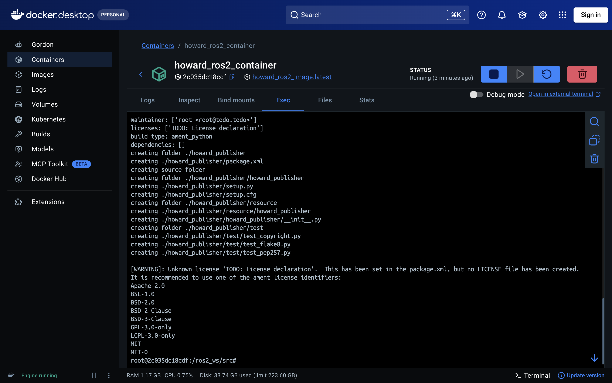

This generates all the boilerplate files (`setup.py`, `package.xml`, etc.) automatically. Now save this as `{your_name}_publisher/{your_name}_publisher/talker.py`:

```python
import rclpy
from rclpy.node import Node
from std_msgs.msg import String

class MyTalker(Node):
    def __init__(self):
        super().__init__('my_talker')
        self.pub = self.create_publisher(String, 'my_topic', 10)
        self.timer = self.create_timer(1.0, self.publish)
        self.count = 0

    def publish(self):
        msg = String()
        msg.data = f'Hello from {your_name}: {self.count}'  # replace {your_name} with your actual name
        self.pub.publish(msg)
        self.get_logger().info(f'Publishing: {msg.data}')
        self.count += 1

def main(args=None):
    rclpy.init(args=args)
    node = MyTalker()
    rclpy.spin(node)
    node.destroy_node()
    rclpy.shutdown()
```

> **Tip:** Since `ros2_ws` is a mounted volume, you can also edit `talker.py` using any code editor on your host machine (VS Code, etc.) — no need to use `nano` inside the container!

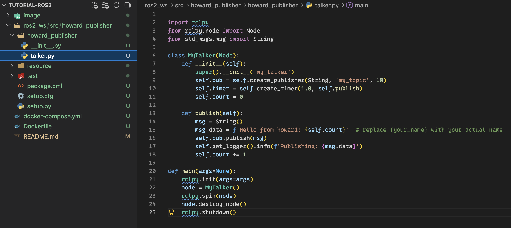

#### 4.4.4 Build and Run

Add node to `setup.py`:

```python
entry_points={
    'console_scripts': [
        'talker = {your_name}_publisher.talker:main',
    ],
}
```

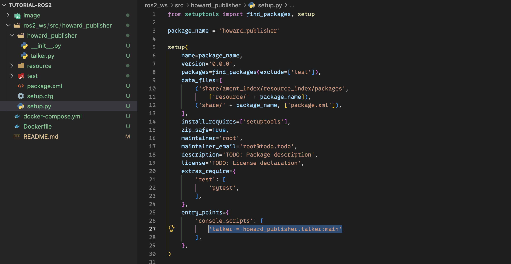

Back inside the container, build your workspace in the `/ros2_ws` folder:

```bash
cd ..
colcon build --symlink-install
```

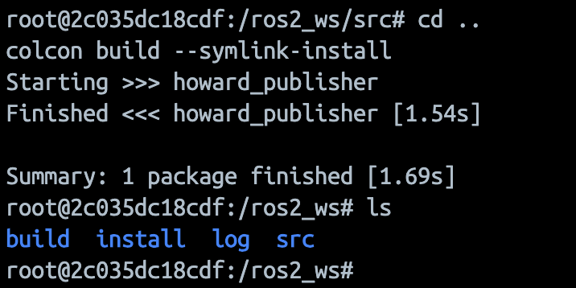

Source the workspace and run your node:

```bash
source install/setup.bash
ros2 run {your_name}_publisher talker
```

You should see `Hello from {your_name}: 0`, `Hello from {your_name}: 1`, ... publishing every second.


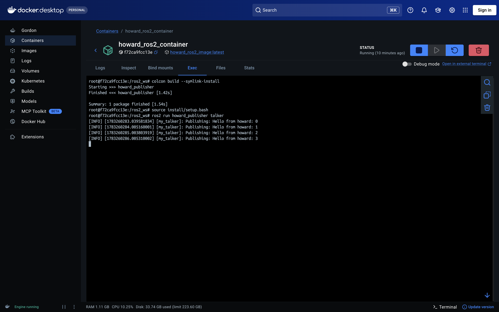
#### 4.4.5 Stop the Container

When done, exit the container (`exit`) and stop it:

```bash
docker compose down -v
```

---

## Section 5: Refining the Docker Setup with Colcon Build

In this section, you'll update your `Dockerfile` so your custom image automatically builds your ROS 2 workspace with `colcon build --symlink-install` during image creation. This means every time you rebuild the image, your packages are compiled and ready to go — no manual `colcon build` needed after entering the container.

### 5.1 Update the Dockerfile

Modify your `Dockerfile` to add the `COPY` and `RUN colcon build` steps:

```dockerfile
# Start from the official ROS 2 Jazzy desktop image
FROM osrf/ros:jazzy-desktop

# Use bash for RUN commands (setup.bash requires bash)
SHELL ["/bin/bash", "-c"]

# Install additional tools (optional)
RUN apt-get update && apt-get install -y \
    nano \
    ros-jazzy-turtlesim \
    && rm -rf /var/lib/apt/lists/*

# Create a workspace
RUN mkdir -p /ros2_ws/src

# Source ROS 2 automatically when you enter the container
RUN echo "source /opt/ros/jazzy/setup.bash" >> ~/.bashrc

# Copy the workspace source code
COPY ros2_ws /ros2_ws

# Build the workspace with colcon
RUN cd /ros2_ws && \
    . /opt/ros/jazzy/setup.bash && \
    colcon build --symlink-install

# Set the working directory
WORKDIR /ros2_ws

# Default command
CMD ["bash"]
```

> **🚀 Performance boost:** Since `colcon build` runs during image build, you won't need to build inside the container manually. The `--symlink-install` flag creates symlinks instead of copying files — this is especially useful because your `docker-compose.yml` mounts the `./ros2_ws` volume, so any Python code edits on your host are instantly reflected in the container without a rebuild.

### 5.2 Rebuild the Custom Image

Because you changed the `Dockerfile`, rebuild the image:

```bash
docker compose build
```

or equivalently:

```bash
docker build -t {your_name}_ros2_image .
```

### 5.3 Run and Verify

Start the container and verify your package is ready without any extra steps:

```bash
docker compose up -d
docker compose exec ros2 bash
```

```
ros2 run {your_name}_publisher talker
```

Your talker should start publishing immediately — no `source`, no `colcon build` inside the container!

> **Tip:** If you add a new package later, just run `colcon build --symlink-install` once inside the container. The next time you rebuild the Docker image, it will be included automatically.

---

## Section 6: Deliverables

Submit the following screenshots as proof of completing the tutorial:

**ROS 2 Communication**
- `rqt_graph` window showing the `/talker` → `/chatter` → `/listener` node graph.

**Turtlesim Simulation**
- Turtlesim blue window with the turtle visible.
- The turtle tracing the **first letter of your last name** using teleop (e.g., "L" for Leung).

**Git Branching**
- Your GitHub repository showing your branch named after you and the `.gitignore` file.
- upload all your code to your branch in this tutorial repository.

**Custom ROS 2 Docker Image**
- Terminal showing your custom `my_talker` node running and publishing messages with your name.

**Update refined Dockerfile**
- Docker image layer showing the `colcon build` step in the Dockerfile.

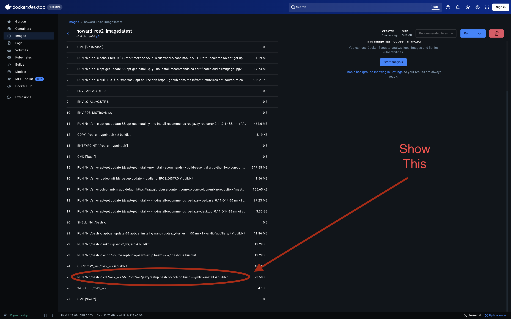

**Autonomous Turtle Controller**
- The turtle drawing **your initials** (e.g., "CKM" for Chan Kwok Ming) **autonomously** — no teleop allowed. 
- Your code pushed to your branch.

You are given only the goal. It is your job to figure out how to achieve it.

**Hints to get you started:**
- `ros2 topic list` / `ros2 topic info` / `ros2 interface show` — explore what topics and messages turtlesim provides
- `rclpy` lets you write subscriber nodes — read the API docs
- The `/turtle1/pose` topic gives you `x`, `y`, `theta` — figure out what each means
- The `/turtle1/cmd_vel` topic accepts `geometry_msgs/msg/Twist` messages — research the message structure
- Self-correction (closed-loop control) is the key to accuracy — keep reading the pose and adjusting velocity
- When stuck, search the ROS 2 documentation and community forums — real engineers do this every day

**Required:**
- A ROS 2 Python package (created with `ros2 pkg create`) containing your autonomous controller node (e.g., 'howard_auto_turtle_pkg')
- The node must subscribe to `/turtle1/pose` and publish to `/turtle1/cmd_vel` — no teleop node running
- A working `Dockerfile` that builds your package
- A short `DEMO.md` explaining how you setup the project, your design choices and what you learned

